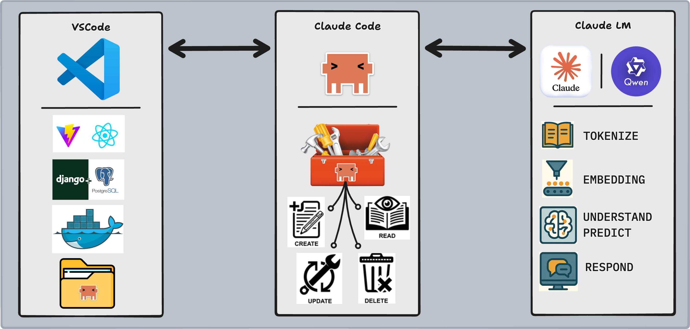

# Installing Claude Code



## Introduction

In the last lesson you learned the architecture: a coding agent is an LLM inside an orchestration loop with access to tools via MCP servers. Now you install one.

This lesson covers three things: installing Claude Code, configuring it to run on a free local model when cloud API costs matter, and understanding how tokens and model selection affect what you pay and what you get.

## Lesson

### Why Claude Code?

Several coding agents exist — you saw the comparison in the last lesson. We use Claude Code in this course for specific reasons that connect directly to the architecture you just studied:

1. **Terminal-first, transparent loop** — Claude Code runs in your terminal and surfaces its agent loop as it works: you see every file read, every tool call, every decision. This transparency is intentional for learning.
2. **Deep MCP ecosystem** — Anthropic created MCP, so Claude Code has the most mature and extensive MCP server support. More MCP servers means more tools available to the agent.
3. **200K token context window** — Claude can hold significantly more code context than most alternatives, which matters when navigating large codebases.
4. **Local model support via Ollama** — You can route Claude Code through a locally running open-source model (no API costs, no internet required). This makes it practical for extended practice sessions.

#### Installing Claude

```bash
curl -fsSL https://claude.ai/install.sh | bash
```

This script installs the `claude` CLI binary to your system. After installation, run `claude` to launch the agent and complete authentication — you'll log in with your Anthropic account or provide an API key.

Once authenticated, you're running Claude Code against Anthropic's hosted models (Sonnet by default). Everything you type is sent to Anthropic's API and billed by token usage.

---

### Setting Up Claude Code

#### Model Selection

```bash
/model
```

Use the `/model` command inside Claude Code to switch models at any time. Running `/model` on its own opens an interactive picker; you can also pass an **alias** directly:

```bash
/model fable      # Fable 5.1
/model opus       # Opus 5.5
/model sonnet     # Sonnet 5.5
/model haiku      # Haiku 4.5
/model best       # Fable where available, otherwise Opus
/model opusplan   # Opus for planning, Sonnet for execution
```

Aliases always point at the latest version of that model family, so they keep working as new versions ship. Pressing `Enter` in the picker saves your choice as the default; pressing `s` applies it to the current session only.

> **Version note:** Model names, prices, and defaults change often. The figures below are from Anthropic's published pricing (September 2026). Check the [pricing page](https://platform.claude.com/docs/en/about-claude/pricing) and the [Claude Code model configuration docs](https://code.claude.com/docs/en/model-config) for current numbers, and run `claude update` to make sure your install supports the newest models.

Different models make different cost/capability trade-offs. Prices are per million tokens (MTok):

| Model | Alias | Input | Output | Context | Tier |
|-------|-------|-------|--------|---------|------|
| **Fable 5.1** | `fable` | $10 | $50 | 1M | Most capable |
| **Opus 5.5** | `opus` | $4 | $20 | 1M | High |
| **Sonnet 5.5** | `sonnet` | $2 | $10 | 1M | Mid-tier |
| **Haiku 4.5** | `haiku` | $1 | $5 | 200K | Low |
| **[`qwen3-code`](https://ollama.com/library/qwen3-coder)** (local) | — | Free | Free | Varies | Practice |

Opus 5.5 and Sonnet 5.5 are both cheaper than the versions they replaced (Opus 4.6 was $5/$25 and Sonnet 4.6 was $3/$15), so the gap between the mid and high tiers is only 2x. Cost still compounds quickly in long agent loops, so the model you choose matters.

##### Fable 5.1

- **Cost**: Highest ($10 input / $50 output per MTok)
- **Best for**: The hardest problems and long-running autonomous work — large multi-file refactors, complex debugging across a big codebase, tasks that take many steps and need sustained reasoning
- **Avoid when**: The task is routine, or you are watching your budget — it costs 2.5x Opus 5.5 per token
- **Access**: Never the default on any plan. You must select it explicitly with `/model fable`, and it requires Claude Code v2.1.257 or later. On some plans, Fable usage bills against usage credits rather than your subscription, and Claude Code asks for consent first

Fable is Anthropic's most capable widely released model. Think of it as the tool you reach for after a cheaper model has hit its ceiling, not as a starting point. Its safety classifiers can occasionally decline a request (for example, in cybersecurity or biology topics), in which case Claude Code automatically falls back to another model. Use `/model` to switch back.

##### Opus 5.5

- **Cost**: High ($4 input / $20 output per MTok)
- **Best for**: Hard algorithmic problems, complex system design, tasks where you've already tried Sonnet and hit its ceiling
- **Avoid when**: The task is routine — paying 2x Sonnet's price for autocomplete is wasteful

Opus 5.5 is the default model for Pro, Max, Team, and Enterprise plans and for API usage. Reserve it for problems that genuinely require it. You'll recognize these: Sonnet gives vague or inconsistent answers, or the problem involves multi-step reasoning across large contexts.

##### Sonnet 5.5

- **Cost**: Mid-tier ($2 input / $10 output per MTok)
- **Best for**: Most coding tasks — architecture discussions, debugging, code review, refactoring
- **Avoid when**: You need maximum reasoning depth (use Opus or Fable) or maximum speed/cost efficiency (use Haiku)
- **Access**: Requires Claude Code v2.1.284 or later

Use it for the majority of your day-to-day work. If your budget matters, this is the model to start from.

##### Haiku 4.5

- **Cost**: Low ($1 input / $5 output per MTok)
- **Best for**: Simple lookups, syntax checks, quick completions, high-volume scripted usage
- **Avoid when**: The task requires reasoning, context, or judgment — Haiku struggles with nuance

Haiku is a tool for programmatic workflows where you're making many small calls and cost compounds quickly. It also has a smaller context window (200K) than the other Claude models listed here.

##### Hybrid: `opusplan`

`/model opusplan` uses Opus to plan a task and Sonnet to carry it out. That gives you stronger reasoning where it matters most (the plan) at closer to Sonnet's price for the bulk of the work (the edits).


##### [`Qwen3-Code`](https://ollama.com/library/qwen3-coder)

- **Cost**: Free (compute cost is your machine's CPU/RAM)
- **Best for**: Practice, experimentation, offline development, learning without billing pressure
- **Avoid when**: You need production-quality reasoning or are debugging a hard problem — local models at this size still lag commercial models on complex tasks


---

#### Determining Effort

Claude Code's **effort level** controls how thoroughly it approaches a task before responding:

| Level | Behavior | Use When |
|-------|----------|----------|
| **Low** | Minimal tool use, fast answer | Quick lookups, simple completions, you know what you want |
| **Medium** | Balanced exploration, reads relevant context | Most coding tasks — the default |
| **High** | Comprehensive analysis, broad exploration | Understanding an unfamiliar codebase, complex bugs, refactors with large blast radius |

Higher effort = more tool calls = more tokens consumed = higher cost. Use High intentionally.

---

#### Output Style

Claude Code's **output style** controls how it communicates decisions to you:

- **Default** — Concise. Shows results, minimal explanation. Fast to read.
- **Explanatory** — Explains reasoning behind decisions. Useful when you want to understand *why* it made a change.
- **Learning** — Maximum transparency. Explains every action, connects decisions to concepts, surfaces trade-offs.

With Learning mode active, Claude Code will explain what it's doing and why it's doing it at each step. This is slower to read but is the difference between *using* a tool and *understanding* a tool. The goal of this course is the latter.

To configure this, run `/output-style` inside Claude Code and select **Learning**.

---

### Context & Tokens

When running against Anthropic's hosted models, every interaction costs tokens. Understanding how tokens work lets you make deliberate decisions about which model to use and how hard to push it.

#### What are Tokens?

A **token** is the smallest unit of text an LLM processes — not a character, not a word, but something in between. Common patterns:

```
"Hello"        → 1 token
"Hello, world" → 3 tokens  (Hello + , + world)
"authentication" → 2 tokens (authen + tication)
" "            → 1 token   (spaces are tokens too)
```

Rough rule of thumb: **1 token ≈ 4 characters ≈ 0.75 words**. A 1000-word essay is approximately 1,300 tokens.

Every API call has an **input token count** (your message + conversation history + tool results) and an **output token count** (the model's response). Both are billed.

#### How are Tokens Measured?

Claude Code shows your token consumption in the session summary. Pay attention to two numbers:

- **Context tokens**: everything sent to the model (grows as conversation history accumulates)
- **Output tokens**: what the model generated (usually much smaller than input)

Long conversations become expensive not because of your latest message, but because every message resends the full conversation history as context.

##### Reducing Cost

Model choice is not the only lever. Two features cut the price of long sessions:

- **Prompt caching**: Claude Code caches the conversation history it resends each turn. Cached reads cost a fraction of normal input (about 10% for most models, and even less for Opus 5.5 and Fable 5.1), which is why long conversations are cheaper than the raw token math suggests.
- **Batch API**: For non-interactive, high-volume work, batch processing gives a 50% discount on input and output tokens.

#### Tokens in English


Before we continue, let's break down this idea of context. Think of your *context window* as a ches. A chess that can very much get filled to the brim.

Now let's say you encounter a room full of coins varying from gold, silver, and bronze coins and it's up to you to fill this box up before you take it home. Ideally you'd want to fill up this box with nothing but high quality gold coins.

This is exactly how you should treat your context window, it should never be over populated with text that doesn't bring any value to the conversation, and keep in mind that every word you utilize adds more and more coins into your chess. We will talk more about this in a future lesson.

### The Status Line

It's extremely useful to create a status line below your Claude Code session so you could easily supervise and view the contents of your session.

Here is an example prompt:

```md
/statusline single line, fully color-coded with truecolor RGB gradient: repo name bold yellow, 🌿 leaf icon + git branch in bold cyan with parentheses, 20-block context bar using 24-bit RGB gradient from green(0,200,80) through yellow(220,200,0) to red(220,40,20) with dark gray(60,60,60) empty blocks, dynamic emoji that changes with usage (🟢 under 20%, ⚡ 20-69%, 🔥 70-89%, 🚨 90%+), percentage colored by usage level, session cost in yellow, code velocity showing +lines in green and -lines in red, 🤖 robot icon + model name in magenta, dim gray pipe separators between all elements
```

### Voice to Chat

There will be many times where your prompt will become extensively large. Typing out extremely large prompts may be time consuming and not necessarily something we should really trouble ourselves with when trying to maximise a coding agent. Instead you could utilize the  `Voice to Chat` feature provided by Claude Code. Simply type in:

```bash
/voice
```

to enable voice to chat. Once you see that voice to chat capabilities have been enabled, simply `hold` down the `spacebar` for Claude Code to start listening, and once you let go it will transcribe your prompts.

---

## Conclusion

You've installed Claude Code, configured a free local model fallback via Ollama, and built a mental model for making cost-aware decisions about which model and effort level to use.

The next lesson moves from configuration to practice: we'll start using Claude Code on real codebases and develop workflows for the kinds of tasks you'll encounter as a developer — reading unfamiliar code, debugging, refactoring, and writing tests with an AI agent actively in the loop.
