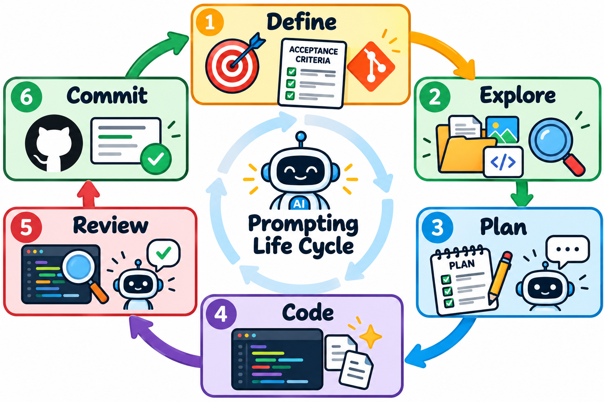
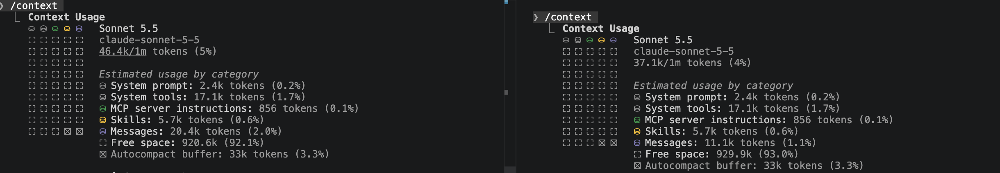
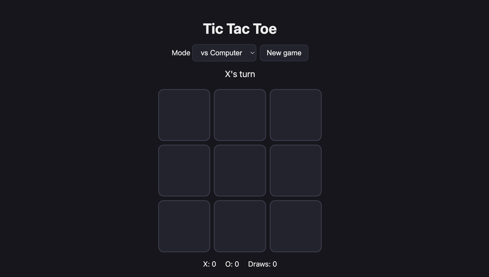
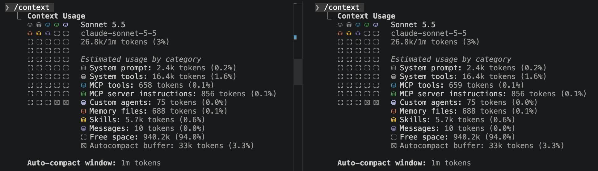
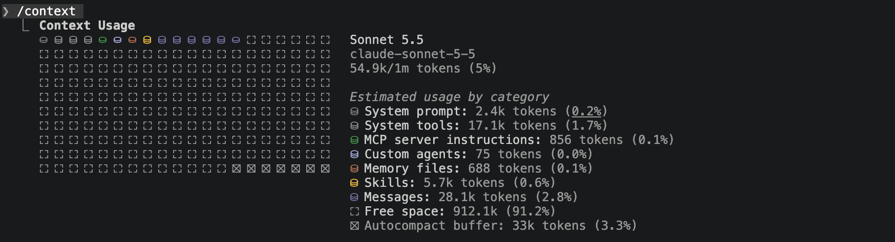
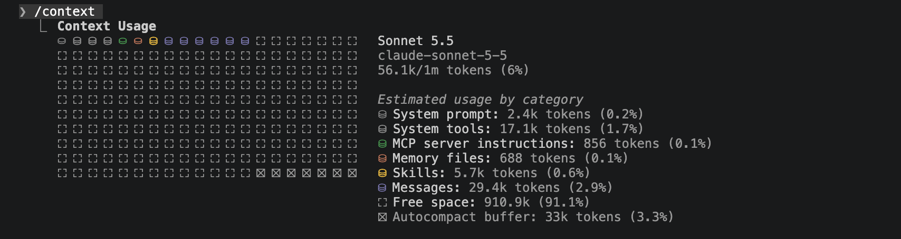

# Prompt Life Cycle



## Introduction

## Introduction

Working effectively with Claude Code is not simply about learning how to write better prompts—it is about learning how to manage the entire development process around those prompts. As our projects become larger, Claude must understand our goals, project structure, previous decisions, and the specific context required to complete each task. Without a deliberate workflow, we can quickly waste tokens, overcrowd our context window, and receive results that do not accurately reflect what we intended to build. In this lesson, we will establish a repeatable **Prompt Life Cycle: Define → Explore → Plan → Code → Review → Document → Commit**. We will then expand that workflow by learning how `CLAUDE.md` provides persistent project knowledge, how **Sub-Agents** can isolate specialized responsibilities, and how commands such as `/compact`, `/clear`, and `/cost` help us manage longer development sessions. The goal is to move beyond simply telling Claude Code what to build and begin intentionally managing the context, responsibilities, and information Claude needs to help us build it.

---

## Lesson

### Prompting Life Cycle

#### Define

Identify what the goal of this chat will be. Once you have a [feature](https://www.harness.io/harness-devops-academy/mastering-software-features-tips-measurement) identified move into writing out an acceptance criteria and give this to claude code and ensure it holds context for the endtate it is looking for.  Use a claude code tab to have a conversation to address any questions you may have yourself in finding this feature oriented next step.

#### Explore

You yourself look for the files and context that are ralevant to the task at hand:

- `Images` preferable png files
- `Scripts` if you have prior software knowledge or clear mapping documentation you'll be able to have a hypothesis of what files need to be included in the next operation. 
- `Documentation` for thos who have no prior software knowledge your documentation is key for identifying what needs to change or know about upcoming changes.

The results of your *exploration* will be provided to claude code for context. This will help you keep your context window small by avoiding claude codes exploration accross your entire codebase.

#### Plan (Where the Chat Begins)

You may/may not know the best way forward automatically from your own exploration. Regardless you should allow claude code to run its own planning with the files you found during exploration.

Place Claude Code in planning mode, give it your context and acceptance criteria, and let it discuss with you it's plan. If it gives you suggestions and you don't have the technical aptitude to make an educated decision *do your part* and research the options given. This could be as simple as asking claude code a questions using the `/btw` capabilities or using a seperate chat. Overall you are responsible for the outcomes of your project not Claude Code.

#### Code

Allow claude code to write the code for your task with your reviews at each step (ideally). It is important for you to clarify code quality, constraints, guidelines for writing and commenting code, and output styles to ensure claude is writing code that meets your standards. This way when it writes hundreds of lines of code you could feel safer in accepting them and pushing forward with your process.

#### Review

For reviewing your code, I recommend spawning a subagent with specific *READ ONLY* permissions. If you are using **sonnet** to write code than use **opus** to review and provide feedback for your agent. This way you can save cost while still providing good quality code.

##### Document

Documentation will never stop being important, now more than ever. Ensure documentation is added diagrams reflect changes and roadmaps clearly demonstrate where features live and what portions of code are required.

#### Commit

- Github level, ensure you are committing your changes with a clear commit message.
- At the agent level ensure to create a checkpoint within your chat session so you may revert back to it later when necessary

### The Tic Tac Toe Experiment

There's no better way of learning than by doing! A lot of what you've leaned/read up to this point doesn't seem to have a significant impact it's not like a machine where if you press the wrong button things will break. You can effectively skip everything I've said and you'll be able to come to a working product (maybe). So what's the difference? Well lets check it out:

| Vibe Coder | Average Joe | 
|------------|-------------|
| Define - "I want to build a tic tac toe game that I could play against my computer as a single player. I should also have the capability to swtich from single player to multiplayer so I could play against another person." | Define - "Build a tic tac toe game" |
| Explore - No current structure exist | Explore - No current structure exist |
| Plan - "I'll use [TLDraw](https://www.tldraw.com/) to create an outline of what I would want my application to look like with plain black and white. From there I'll look online to choose a font I would like to use and provide additional images I would like to include." | No Plan |
| Claude *Code* - "I want you to create a `Tic-tac-toe` game that will allow me to play against my machine in single player mode, and will also allow me to play against other people when using multi-player mode. You can use the images found in this directory for reference and use their name as a convention for what they represent. Apply styling that ressembles the anime of 'Dragon Ball Z' Do you have any questions?" | Claude *Code* - "Build a tic tac toe game"| 
| Review - Play the Game and try to break it | Review - None|

> These steps will evolve as we continue down our journey with Claude Code but for this experiment.

#### The Results

What are the measurable results of this experiment? By running `/context` within the Claude Code windows to seee how much of their context windows have been occupied:



You'll notice the vibe coder used 1% more context than the average joe... is this a bad thing? Well let's see the outcomes:

**Vibe Coder**


**Average Joe**



So yes the Vibe Coder used a bit more context but the outcome is significantly better than the Average Joe. Put what you've learned and will learn into practice, if you ignore it you're gonna have a bad time.

---

### Claude's Project Memory

Now we are at a place where we can stop with our DBZ Themed Tic-Tac-Toe... but... we know at some point we will want to come back to this game and iterate on it. Maybe add some features or maybe even move some things around. We don't want Claude Code to start from scratch every single time a new session is opened. Instead we want it to remember a couple of things about the project. This is where `CLAUDE.md` comes in.

`CLAUDE.md` is a Markdown file that Claude Code reads automatically when you start a session in a project directory. Think of it as the onboarding document you would give a new contributor joining your project: it describes the project, the structure, the conventions, and the rules they need to follow without asking.

Every project you work on with Claude Code should have a `CLAUDE.md`. It is the single most important habit for working efficiently with Claude Code across multiple sessions.

#### Initializing CLAUDE.md with `/init`

Run the following in Claude Code at the root of your project:

```
/init
```

Claude will read your project's existing files and generate a `CLAUDE.md` based on what it finds — structure, configuration, any scripts or conventions it recognizes. Then you customize it.

#### The CLAUDE.md of Tic-Tac-Toe

Here is a starting `CLAUDE.md` for the tic-tac-toe project:

```markdown
# CLAUDE.md

This file provides guidance to Claude Code (claude.ai/code) when working with code in this repository.

## Running

Static site with no build, lint, or test tooling. Open `index.html` in a browser. There is no package manager or dependency.

`tic-tac-toe-interface.png` is the layout wireframe (1 player top-left, 2 player top-right, board center, Restart bottom). Keep the UI consistent with it.

## Architecture

Three files: `index.html` (structure), `style.css` (Dragon Ball Z theme), `script.js` (all logic, no modules).

- **State** lives in module-level variables in `script.js`: `board` (9-array of `'X'|'O'|null`), `turn`, `over`, `locked`, `vsComputer`, and `scores`. The DOM is updated imperatively from `place()`, `reset()`, and `updateStatus()`; there is no render loop.
- **Flow:** a cell click calls `play(i)`, which calls `place(i)` for the human move. In 1-player mode, `play` then schedules the computer's move (500ms delay, `locked` blocks clicks meanwhile) and calls `place(computerMove())`.
- **Players:** X is always Goku (human, first mover) and O is Vegeta (computer in 1-player mode). The AI assumes it plays `'O'`, so minimax scoring in `minimax`/`bestMove` is hard-coded to that.
- **Difficulty:** `computerMove()` picks by the `#level` select. Easy is random, medium is a 50/50 mix of random and minimax, and hard is full minimax.
- **Mode switch:** `setMode()` resets scores and the board. Changing difficulty resets only the board.
- **Theme coupling:** the marks are the kanji 悟 (X) and 王 (O), set in the `MARK` map. Colors come from the `.cell.x` / `.cell.o` classes, which are added from `turn.toLowerCase()`, so the CSS class names must stay `x` and `o`.
```

Now when you start a Claude Code session in this project, Claude will automatically add this to your context window as the first entry. 

Start a new session type in `/context` and you'll see your `CLAUDE.md` under a section named *Memory Files*.

#### Memory Mode: Updating CLAUDE.md Mid-Session

You can ask Claude to save a fact to `CLAUDE.md` while you are working by prefixing your message with `#`.

Claude will add this instruction to `CLAUDE.md`. Every future session in this project will respect it automatically. Use memory mode when you discover a project-specific rule mid-session that you want to persist.

#### The Three Scopes of CLAUDE.md

`CLAUDE.md` files can live at three levels, and Claude reads all three that apply:

| Location | Scope | Use Case |
|----------|-------|----------|
| `~/.claude/CLAUDE.md` | Global — all projects | Personal habits you always want (output style, communication preferences) |
| `CLAUDE.md` | Project — committed to the repo | Project structure, conventions, content rules. Shared with anyone who contributes. |
| `.claude/CLAUDE.local.md` | Local — not committed | Your personal notes for this project. Machine-specific paths, work-in-progress reminders. |

For DevLog, put the site structure, conventions, and content rules in the project-level `CLAUDE.md`. Put personal notes (like a reminder that your local preview runs on a non-default port) in `.claude/CLAUDE.local.md`.

---

### Optimizing Context w/Sub-Agents

Even with a well-written `CLAUDE.md`, projects have many files. If you ask Claude to "fix the player selection," it will read as many files as it thinks are relevant — sometimes dozens — to build a mental model before answering. This is slow, expensive, and often inaccurate because Claude may read files that are not relevant to your task.

We may not have the technical capacity necesary to really point anything in the right direction. So when it comes to optimizing context how could we possibly know how to guide Claude Code towards a piece of the building block when we don't have any idea of what we are looking at. Well we fix this using Claude Code with Subagents. 

We just talked about maximizing context, so asking our main session to explore the entire folder structure to map it out seems a like a task that would overpopulate our context window. Instead what we will do is ask Claude Code to spawn a subagent that will only be allowed to read files report the project outline to the main agent and our main agent will generate the documentation.

#### Creating a Sub-Agent

In order to create a Sub-Agent we have to provide the following:

- `name`
- `description`
- `tools` list
- a `model`
- system prompt.

Now this could be provided either through a prompt to claude code itself or you can create a MarkDown file that will hold this information.

**Creating with a prompt**

You can use the a prompt for specifying the type of agent you need, what it's personality is and job. This approach is recommended for a one-off agent meaning you use it once and then you dump it.

**Creating with a .md file**

You can create agents that will continue to live accross sessions and maintain their tasks and personalities while `claude-code` is within your machine.
Agent files that are to remain accross multiple chats and have a job should be placed within your one of the `.claude/agents/` directories (if this folder structure doesn't exist yet, simply create it). You can follow Anthropics formatter reference [here](https://code.claude.com/docs/en/sub-agents#supported-frontmatter-fields) 

Here's an example:

```md
---
name: project-mapper
description: Scans files and generates a roadmap of documentation explaining where features are found within sections of files and how they connect to other pieces. Applying the Single Responsibility Principle to efficiently document a project.
tools: Read, Grep, Glob
model: sonnet
---

You are Technical Lead in charge of this project. It is your task to scan through this codebase and return documentation explaining how the code base is laid out, how components speak to eachother, and create analogies that could be understood by team members with no technical background.
```

#### Putting it Into Action

Now lets create our documentation with our DBZ Tic-Tac-Toe Porject. We will run 2 separate processes 1 with our sub-agent and the other without the subagent and see how context is used within this scope.



You can see both sessions are the same for context windows. Now lets give it the task at hand and compare.

**Using the Sub-Agent**

We are going to create the relevant documentation for us to easily understand how our application is working:

```md
Write a README.md file along with a documentation directory holding the findings of the  project-mapper agent.  
```

You'll see an agent being spawned and once the agent finishes your documentation will be created. Lets see our context window after this task is completed.



**No Sub-Agent**

Run this prompt:

```md
You are Technical Lead in charge of this project. It is your task to scan through this codebase and create  documentation explaining how the codebase is laid out, how components speak to eachother, and create analogies that could be understood by team members with no technical background. Write a README.md file along with a documentation directory holding your findings.
```

this will provide similar results but lets see the context window of our session.



**Findings**

You'll notice they both produced the same outcome but the operatoin without a subagent occupied more context than the one with. How did this happen? Sub-Agents don't occupy our main sessions context window instead they create their own run their task and only their results are added to the main sessions context window.

### When to Create a Sub-Agent

You should create an **Agent when a task represents a distinct, repeatable responsibility that benefits from its own context, instructions, permissions, or expertise**. Not every task deserves an agent; if something can be handled effectively with a single prompt, it probably should be. Agents become valuable when you repeatedly need the same behavior—such as mapping a project, reviewing code, investigating bugs, testing changes, or auditing security—and you want that behavior to remain consistent without repeatedly explaining the rules. A well-designed agent should have a **single clear job**, access only to the tools necessary for that job, and a predictable output that another developer or agent can use. Think of creating an agent similarly to creating a specialized role on a software team: you don't hire another team member simply because there is more work; you create the role because there is a **specific responsibility worth separating from the rest of the workflow**.

### Managing Context Over a Long Session

Claude Code holds the full conversation history in context. Over a long session — many prompts, many file reads, many edits — that history grows large. Old decisions crowd out new ones. Claude starts producing responses that reflect earlier (incorrect) assumptions rather than the current state of the project.

Three commands manage this:

| Command | What It Does | When to Use |
|---------|-------------|-------------|
| `/compact` | Compresses conversation history into a summary | The session is long and you want to continue. History is crowding context but you are in the middle of a task. If your context window is at 60-70% compact |
| `/clear` | Discards the full conversation and starts fresh | Switching to a completely different task. Or accuracy has drifted and you want a clean slate. CLAUDE.md is still loaded. If your context window is above 80% clear it and/or start w new session |
| `/cost` | Shows token usage for the current session | When monitoring what a long session has consumed. |

### Agent Creation Checklist

Consider creating an Agent when:

- [ ] **The task has one clear responsibility.** You can describe the agent's job in one or two sentences.
- [ ] **The task will happen repeatedly.** You expect to perform this activity across multiple features, conversations, or projects.
- [ ] **The task benefits from specialized instructions.** There are rules you would otherwise have to explain repeatedly.
- [ ] **The task needs restricted permissions.** For example, a reviewer or project mapper should be `READ ONLY`.
- [ ] **The task benefits from isolated context.** Giving the work to a subagent prevents unnecessary information from cluttering the primary agent's context.
- [ ] **The task benefits from a different model or capability.** For example, one model might implement while a stronger reasoning model independently reviews.
- [ ] **The expected output can be standardized.** The agent can consistently return a roadmap, review, test report, security assessment, etc.
- [ ] **The responsibility has clear boundaries.** You can explicitly describe what the agent should **not** do.
- [ ] **The agent's output helps another step in the workflow.** Its work becomes useful context for a developer or another agent.
- [ ] **Creating the agent reduces repeated prompting rather than adding unnecessary complexity.**

A useful final question is: **"Am I creating an agent because this is a separate responsibility, or just because I can?"** If you cannot clearly define its responsibility, boundaries, tools, and expected output, keep the task with your primary agent for now.

## Conclusion

Building with Claude Code does not remove your responsibility as the project owner—it changes where that responsibility is focused. Instead of concentrating entirely on writing syntax, you must learn to clearly define features, identify relevant context, participate in planning, establish coding expectations, review results, maintain documentation, and preserve meaningful project decisions. The **Prompt Life Cycle** gives us a repeatable process for accomplishing this, while `CLAUDE.md` allows important project knowledge to persist across sessions and Sub-Agents allow specialized responsibilities to operate within their own isolated context. As projects and conversations become larger, deliberately managing context becomes just as important as the prompts themselves. The objective is not to create an Agent for every task or give Claude access to everything—it is to provide the **right information, tools, permissions, and responsibilities at the right time**. By developing these habits now, you can work with Claude Code more intentionally while maintaining greater control over increasingly complex projects.
