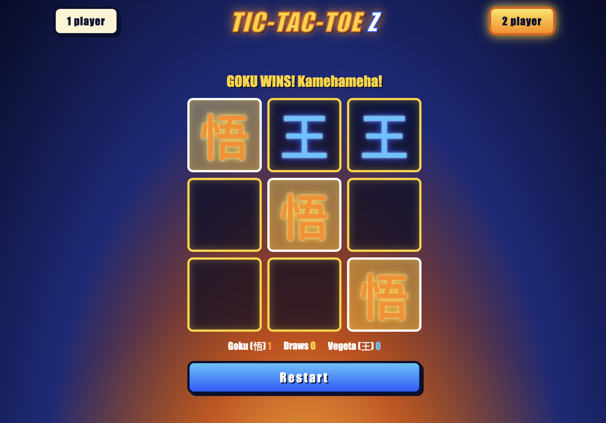
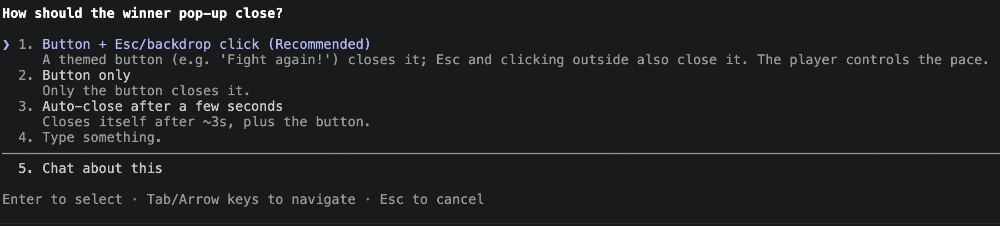
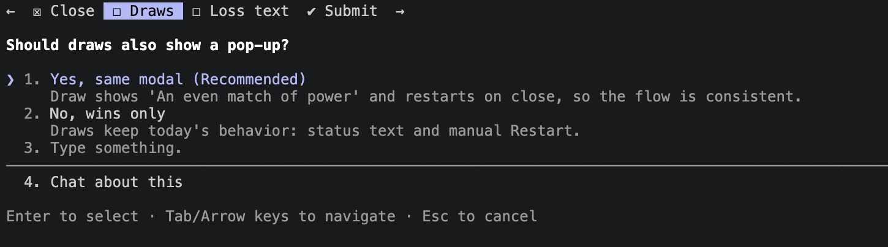
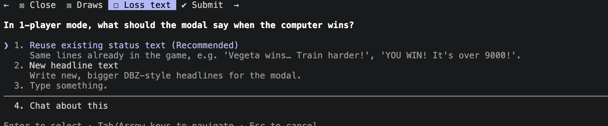
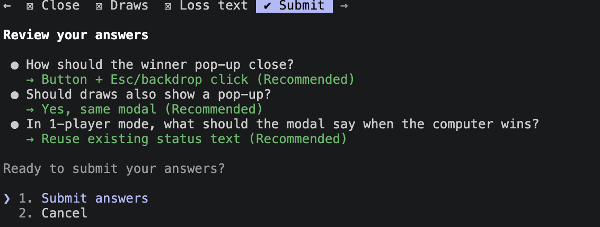
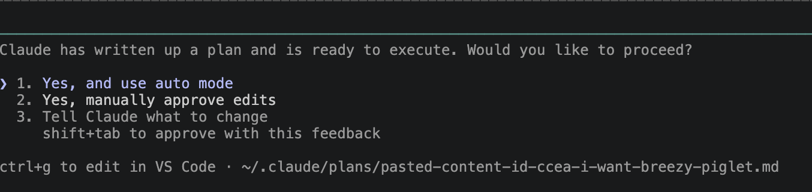

# More out of Claude Code

## Introduction

As our projects grow, working effectively with Claude Code becomes less about simply asking it to write code and more about learning how to manage the development process around it. In this lesson, we will revisit the Define → Explore → Plan → Code → Review → Commit workflow and improve how we approach each stage. We will learn how project documentation can help us provide Claude with focused context, how Planning Mode can help us think through changes before implementation, and how tools like MCP servers, Playwright, and specialized agents can extend Claude Code beyond the codebase itself. The goal is to move from simply asking Claude Code to build features toward creating a structured workflow where we provide the right context, delegate specialized tasks, review results, and continuously improve our application without unnecessarily consuming our main session's context window.

---

## Lesson

### Revisiting Our Project

Our project has been alive for a couple of days now and it's time we start adjusting some features within it. There'a a few things we have to consider before assigning tasks to Claude Code. Lets revisit the life cycle:

```txt
Define >> Explore >> Plan >> Code >> Review >> Commit 
```

---

### Define+

Now that we have a well documented project, we can read the documentation provided by Claude Code to determine which files and blocks of code would be impacted by generating a new feature.

This is what my current DBZ themed Tic Tac Toe project looks like:



The easiest feature I would like to add is a pop up when someone wins the game announcing the winner and restarting the game once the pop up closes.

---

### Explore+

Most people will request Claude Code itself to conduct the *exploration* portion of writing a prompt and to an extent this is acceptable but you should take into consideration the following:

- How much Claude Code tokens do you have? Are you using a plan or an API Key? You don't want to waste your tokens (tokens and context windows are not the same!)
- How big is your project? Don't pull down a project that has hundreds/thousands of `LOC` (Lines Of Code) and ask Claude Code to skan through all those files. It will use an immense mount of tokens before it even starts working on developing your feature.

Here's what I recommend, we asked Claude Code to generate documentation and as the project owner you should be very familiar with how this works. Read the docs and find out what portions of your project will be impacted. 

#### My Findings

In my main `README.md` I found the following section:

```txt
## Project layout

dbz-tic-tac-toe/
├── index.html                 Structure: what is on the page
├── style.css                  Looks: colors, fonts, animations (DBZ theme)
├── script.js                  Behavior: rules, turns, scoring, computer opponent
├── tic-tac-toe-interface.png  Wireframe of the intended layout
├── CLAUDE.md                  Short guidance for AI coding assistants
└── docs/                      Detailed documentation (below)
```

This alone tells me that both `index.html` and `script.js` are the ones holding the details I need for creating the pop up and restarting the game upon closing. This way when I write my prompt for Claude Code I know what files to hand over as context.

---

### Plan+

Now that I have my findings I can generate a plan for implementing this. As of now we don't have the skills to really talk to this as a developer so lets bring in Claude Code to help us generate a plan for generating this feature.

We are goint to place Claude Code into something called `Planning Mode` which is a *READ* only mode that will allow Claude Code to use your context determine if it needs more and ask multiple questions to come up with a plan for implementation.

> You place claude in planning mode by pressing `shift + tab` on the main session until you see plan on the lower left hand corner.

Start your session, get into planning mode, and your prompt:

```text
I want to add a feature to this DBZ themed Tic Tac Toe game. Currently when someone wins the game they have to manually click `restart` in order to play the next game and there's no real signal that someone won the game.

I would like you to make it, where when a player wins the game a DBZ themed pop up in the center of the screen populates announcing the winner. Upon the modal closing the game should restart and be ready to start a new round.

From reading the documentation I believe you'll need to interact with these files:
- @index.html
- @script.js

Do you have any questions?
```

> the `@` symbol in Claude Code is used to directly reference claude code to a file. Without the `@` symbol in front of a file, Claude Code will search through the entire Code Base and occupy unnecessary amounts of additional context.

#### Planning Interactions

Since we are on planning mode Claude Code was able to ask me a series of questions to ensure it builds the feature that I want. Here's what my session looked like:









Notice, in almost in every question you are given a change to carry a conversation with Claude Code. If at any point you have some additional questions to make the best educated decision, use the `/btw` command so you can ask questions without diluting your current sessions context window.

When it's over Claude Code will generate a plan and show you where the plan will be stored in folder structure. Hold `cmd` down and click on that file path to view it. Or scroll up and read the output from claude.



---

### Code+


Claude Code is done planning and it's ready to implement, we don't currently have the knowledge to properly approve it so lets use auto mode to generate these changes.

Now that changes have been made to the project ensure you ask claude code to update your documentation.

---

### Review+

As of now we don't have the technical capabilities to supervise the output of Claude Code the way we should so the only real behavior we can accomplish in review is by actively interacting with the feature. Not a bad plan at all... but it is pretty time consuming. Right now it's a simple tic tac toe game and we have to review:

- layout
- responsiveness of each players turn
- game behavior in multiplayer
- game behavior in single player
- modal pop up
- restart of game

Thats a lot of different concepts to check out. There's gotta be a more efficient way to ensure this is panning out. Now I'm not saying we should never test things manually at some point we definitely want to find *bugs* within the application. But until then we don't want to manually check every feature everytime we change something this would waste a lot of time.

This is where additional MCP Servers come in.

#### What Is MCP?


**MCP (Model Context Protocol)** is an open protocol that defines how external tools communicate with Claude Code. Think of it as a plugin system: an MCP server is a small program that exposes a set of capabilities — tools, in MCP terminology — that Claude can call during a session.

Without MCP, if you ask Claude to "check that the navigation links work," Claude can only reason about your files. It cannot run the site, open a browser, and click through the menu. With Playwright MCP installed, Claude can do exactly that — open a real browser, navigate, interact, and report back.

MCP servers can expose capabilities in three forms:

| Form | What It Gives Claude | Example |
|------|---------------------|---------|
| **Tools** | Functions Claude can call | `browser_navigate`, `browser_click`, `browser_screenshot` |
| **Resources** | External data Claude can read | Files, database records, API responses |
| **Prompts** | Pre-written prompt templates | Reusable instructions for common tasks |

Most MCP servers you will encounter in practice expose tools — functions that do things and return structured results.

---

##### How MCP Servers Work

The flow when Claude uses an MCP tool:

```
Claude decides it needs a tool (e.g., "navigate to /projects")
                    ↓
Claude Code sends the tool call to the MCP server process
                    ↓
The MCP server executes the action (opens a browser, navigates)
                    ↓
The server returns a result (page title, screenshot, visible text)
                    ↓
Claude reads the result and continues its response
```

MCP servers run as separate processes on your machine. Claude Code starts them when a session begins and communicates with them over standard input/output using a structured JSON protocol. From Claude's perspective, an MCP tool call looks the same as any other tool call — the difference is that the MCP server, not Claude Code itself, executes the underlying action.

---

#### Playwright MCP: A Browser for Claude

**Playwright** is a browser automation framework — it can open real browsers (Chromium, Firefox, WebKit), navigate to pages, click links, fill forms, take screenshots, and read page content. The **Playwright MCP server** wraps these capabilities as MCP tools and makes them available to Claude.

With Playwright MCP, Claude becomes a live site reviewer. Instead of asking Claude to reason about whether a page would look right, you ask it to actually open the page and report what it sees.

#### Installing Playwright MCP

Exit your current Claude Code Session and execute the following command in your terminal:

```bash
claude mcp add playwright npx @playwright/mcp@latest
```

> This will install PlayWright globally so it should only need to happen once and all sessions will have it available to them.

Now open your session again with:

```bash
claude -c
```

The `-c` command stands for continue, meaning that Claude Code will reopen your most recently closed session while maintaining it's context. Next, lets check what *MCP* servers are available with `/mcp`. This will show you a section of `Local MCPs` where you'll see `playwright` displayed.

##### What Tools Playwright MCP Provides

Once installed, Playwright MCP exposes tools that Claude can use directly:

| Tool | What It Does |
|------|-------------|
| `browser_navigate` | Navigates to a URL |
| `browser_click` | Clicks an element by text or CSS selector |
| `browser_type` | Types text into an input field |
| `browser_screenshot` | Takes a screenshot and returns it as an image |
| `browser_get_text` | Returns the visible text of a page or element |
| `browser_wait_for` | Waits for an element to appear before continuing |

Claude selects and sequences these tools based on what you ask it to do — you describe the task in natural language, and Claude figures out which tool calls achieve it.

#### Leveraging PlayWright for Review

Now let's use everything we've learned up to this point to review our project and ensure it's working well. We don't know what we don't know so sometimes without the technical expertise we are better handing this off to Claude.

**QA Agent**

```md
---
name: qa-agent
description: Using the PlayWright MCP server open the dictated browser tab to check the provided list of features and dynamic layout.
tools:
  - mcp__playwright__*
model: opus
---

You are a member of the Quality Assurance team. Your job is to use the PlayWright MCP to open the provided browser url and check the provided feature list. It is your job to ensure dynamic and adaptive styling for both mobile and desktop is maintained following standard front end development and design conventions.

## Arguments

1. **Browser URL**: the location where the project is currently being hosted.
2. **Feature List**: a list of features to be tested with playwright mcp.
```

> You'll notice we are using `opus` and not `sonnet` for this task. Since it's job is to review and it has client related interactions we want to increase it's power by leveling up our model.

Here's the prompt I'll use:

```text
❯ I need to ensure this project is working well, open this project in a local browser. Once the project is open use the qa-agent by giving it the location of the project and the list of features from @README.md.

Once the agent comes back with it's findings update the code base and ensure to update the documentation to reflect the new state of the project.

Do you have any questions?
```

Here's the checkpoint response:

```text
The site is open in your browser, and a local server is running at `http://localhost:8765`. I've given the `qa-agent` that URL, the project path and the feature list from the README. It's testing in the background. When it reports back, I'll fix the code and update the docs to match. I have no questions for now.
```

This is great, I know my own context window isn't being diluted with the explorations of my QA-Agent and only what I need will be added to context.

Final Response:

```text
I've fixed the QA findings and updated the docs. The QA agent is now doing a last check on the two newest changes, phone-landscape layout and keyboard focus. I'll report its result when it arrives.

The first QA pass found one high-severity bug plus layout and accessibility problems. The re-test confirmed the main fixes. The two newest changes came out of that re-test.

- **Computer move timer:** it was never cancelled, so pressing Restart, switching mode or changing difficulty during the computer's 500ms pause could place a stray Goku mark on the new board. `reset()` now cancels the timer. The 700ms pop-up timer is cancelled the same way, which also stops the pop-up opening early after a fast 2-player round.
- **Phone layout:** the mode buttons and title no longer wrap at 320–414px. In phone landscape the board and Restart button now scale to the screen height, and the Restart button matches the board's width. I haven't yet confirmed that Restart fits without scrolling, because the agent's re-test was still partial when I made the second fix.
- **Accessibility:** each cell's label now names its owner (for example "Cell 5, Goku"). The status line is announced to screen readers, the mode buttons show which one is selected, and I removed the invalid `role="grid"`. After a move, focus now goes to the first free cell instead of being lost.
- **Favicon:** I added an inline 悟 icon, which removes the only console error (a 404).

The agent also confirmed that modes, difficulty levels, scoring, status messages, the winning-line flash, the pop-up and the wireframe layout work correctly.

I updated `docs/known-issues.md`, `game-flow.md`, `architecture.md`, `styling-and-theme.md`, `README.md` and `CLAUDE.md` to match.

The local server is still running at `http://localhost:8765` (`python3 -m http.server`). Tell me if you want me to stop it.
```

It did all of this while maintaining a `7%` context window and my application is considerably better than it was before.

---

## Conclusion

Claude Code becomes considerably more powerful when we stop treating it as a single coding assistant and begin treating it as part of a larger development workflow. By understanding our project's documentation, identifying the files affected by a change, using Planning Mode before implementation, and delegating specialized work to agents equipped with tools such as Playwright MCP, we can give Claude clearer responsibilities while keeping our main session focused. Most importantly, automation does not eliminate the need to review our application—it gives us another layer of support for performing that review more consistently and efficiently. As you continue building, focus on becoming better at defining what you want, supplying intentional context, choosing the right tools for each task, and validating the results. The better you become at managing this process, the more effectively you can use Claude Code to build, test, and improve increasingly complex applications.