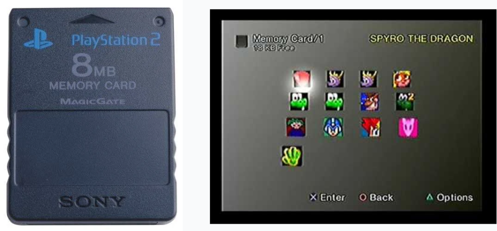
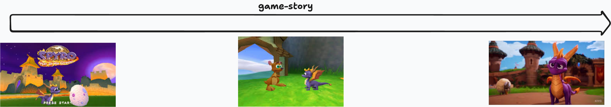
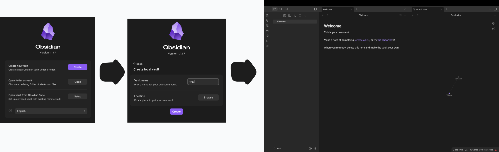
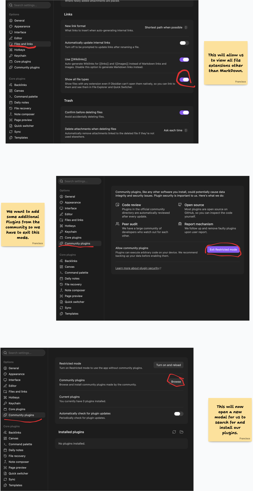
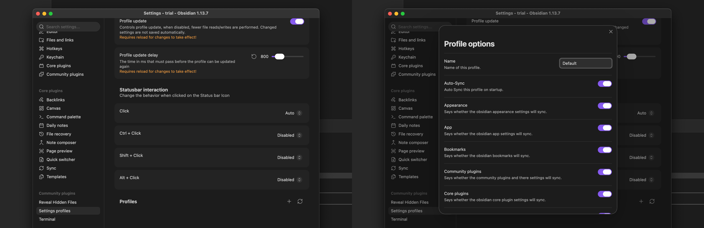
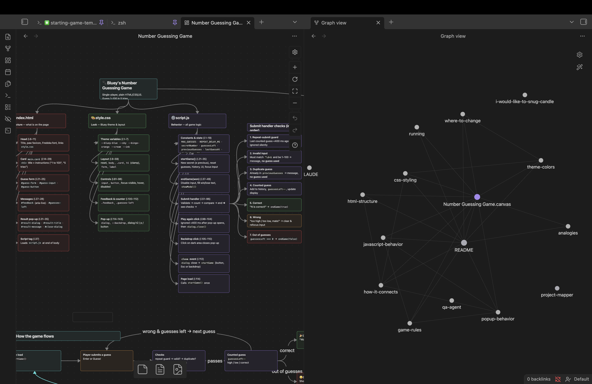

# Committing Your Context

## Introduction

As our projects become more complex, **memory** becomes an increasingly important part of working effectively with Claude Code. We need ways for Claude to remember previous conversations and decisions, but we also need ways to preserve, understand, and revisit the different states of the applications we are building. In this lesson, we will explore memory from both perspectives. We will learn how Claude Code sessions can be resumed, renamed, and rewound through checkpoints, and then introduce **Obsidian** as a visual knowledge-management environment for organizing our projects, documentation, and development workflow. Finally, we will bring these concepts together by building a Number Guessing Game while applying our **Define → Explore → Plan → Code → Review → Commit** process and using tools such as `CLAUDE.md`, specialized agents, documentation, and Obsidian Canvas to preserve not just our application, but our understanding of how it works.

## Lesson

### What is Memory?

For humans, memory means we have the ability to recall previous events, knowledge, sounds, etc. We develope memory by using a combination of our five senses along with our reasoning and personalities for who we are. The process is a lot more complicated than that but I'm no one to try to explain that to you. Even after this data is captured by our brain, our brain than chooses to store it in different categories of memory depending on how important the information is and how often we have to use it.

To a machine, memory is an entire different thing. At it's core it shares the same basic value which is the ability to *recall* stored data. The way it goes about it is way more robotic in nature. It only remembers things we explicitly tell it to. For anyone using Microsoft Word, if you don't turn on the auto save setting your machine won't maintain the changes you've made to a document. A machine is not able to tell you "this is what your document looked like 5 minutes ago" because machines only store the latest version of something you've saved.

### The Analogy

The best analagy I could think of for Computer Memory is the good'ol PlayStation Memory Card. In case you don't remember it here is a blast from the past:



This piece of equipment functioned in a very simple way. You made progress through your game and when you were ready to *save* you simply clicked *start* on your playstation, selected an empty slot, and saved your game. This way you could turn off your game, and later on when you return to the game you could choose the saved file to load the last state of your game. 



When you ran out of space, you had to make a sacrifice and choose which spot to overwrite with the newest state of your game. Computers basically do that constantly to maximize efficiency. Every time you *save* your project the previous version was *over written*. 

For the most part this works, but for us trying to develop applications, it is a problem that needs to be solved. What's the closest answer? Every time we hit a checkpoint, make a copy of our entire project and change it's naming convention by numerical addresses. This is a band aid, not a solution. So how do we fix it???

We need to isolate the two things that need to retain knowlege/memory:

1. Claude Code: Needs the capability to hold important context, agents, project oriented context, commands, mcps, etc. Most importantly conversation need to have ways to move forward, backward, middle, etc.
2. Projects: Projects must also be managed in theri ability to move forward, backward through it's verious states. 

Unfortunately these two problems don't share the same answer.

### Addressing Memory For Claude Code Sessions

Somthing really interesting you may have noticed about the [Claude](https://claude.ai/) in comparison to Claude Code is that on the sidebar you have the capability to *resume/continue* previous conversation that you may have had with the agent. It retains the context that it's developed in the past and carry on the conversation with you as if you never left or closed the browser. Well that capability is also inclued within Claude Code.

#### Resume/Continue a Session

Open up a brand new Claude Code session in your terminal and run the `/resume` command. This will populate a scrollable menu that will allow you to choose from previous conversation and effectively load any context that was left there. This is a huge step forward for not having to rebuild context.

Additionally when you open up claude you can add the `-c` command to continue the most recently closed conversation. Is useful if your VSCode closes for updates o fany sort and you quickle want to get back into your previous session.

Now this `/resume` menu seems pretty useful, but the naming convention seems to bit pretty weird and dependent on what your initial prompt was. This could be very confusing and may need adjustment from time to time. If you decide a session needs a new name, you could run `/rename` while a session is already running or you could use `claude --name 'name'` to start a new conversation with a predetermined name.

Again:

| command | output |
| --------|--------|
| `/resume` | Will open a scrollable menu of previous conversations |
| `/rename` | Will allow you to rename an already running session |
| `claude -c` | Will open the most recently closed conversation. |
| `claude --name 'name'`| Will open a new session with the dictated name |

#### Checkpoints through Sessions

These checkpoints for Claude Code (think of a slot in a playstation memory card) is stored after each prompt you run through it. These Checkpoints are fantastic in the fact that they don't only store your context and protect it but in the fact that they also store your codebase. You can use `/rewind` to get a list of these checkpoints so you may go back to them.

> BE WARNED: Checkpoints only work backwards and once done there is no undoing it. Be wise about this feature.

### Claude Code + Obsidian

This is definitely not a must, but certainly a huge plus when it comes to interacting with Claude Code when you don't have previous technial knowledge. 

[**Obsidian**](https://obsidian.md/) is a note-taking and knowledge-management application that stores your notes as local **Markdown (`.md`) files** and allows you to connect those notes using links, creating a personal network of information. Rather than organizing everything strictly into folders, Obsidian encourages you to create relationships between ideas—for example, a note about **Claude Code Agents** could link to notes about **MCP Servers**, **Context Management**, and **Prompt Engineering**. Obsidian can then visualize these relationships as a graph, making it useful for building documentation, course material, research notes, technical knowledge bases, and personal “second brains.” Because the underlying notes are ordinary Markdown files stored on your computer, they remain portable and can also work naturally alongside tools such as VS Code, Git, and AI coding assistants.

All of our interactions up to this point have been very terminal oriented. Now it's time we start adding some Visualization and a much better memory aspect for both Claude Code and ourselves on how the codebase works.

#### Setting Up Obsidian Environment

##### 1. Installing Obsidian

We need to install the actual Obsidian platform onto our machines. Click [here](https://obsidian.md/download) to get the installation guide.

> If you are on MacOS, make sure to drag the Obsidian app onto your applications folder other wise it won't work properly.

##### 2. Open Up your first Vault

When you open up Obsidian for the first time it will ask you open a *Vault*(This keyword is essentially a directory where obsidian is instructed to set up it's own workspace within). Follow the directions listed to create a new directory/vault



##### 3. Preparing For Development

As mentioned, the primary purpose for Obsidian is note taking with Markdown files. It's not an `IDE` by default but it can be altered to be one. We just need to change our configurations a little bit. Let's set up for Development by bringing in `community plugin`(features created and open sourced by the comunity that we can add to Obsidian and use right out of the box). Let's change our settings and add our plug ins:

Open up the settings/preferences menu and follow this process:



Now let's install the Plug Ins we will need:

- [Reveal Hidden Files](https://community.obsidian.md/plugins/reveal-hidden-files)
- [Terminal](https://community.obsidian.md/plugins/terminal)
- [Claude IDE](https://community.obsidian.md/plugins/claude-code-ide)
- [Settings Profile](https://community.obsidian.md/plugins/settings-profiles)

Ensure to enable all of them When you start.

##### 4. Open a terminal

You'll notice back in the main Obsidian Vault there is an `Open Terminal` button. Go ahead click on that and select the `Integrated` option to open the terminal. This will open a direct terminal within the Obsidian Vault for you to interact with.

You can run regular bash commands to interact with this *vault/directory* and it'll work perfectly.

##### 5. Open Claude Code

Now you can open up Claude cCde with the command `claude`. But we want it to have integration with Obsidian itself so we'll utilize the Obsidian Clude IDE to do this. Execute `/ide` to choose it from the drop down menu.

##### 6. Save your settings

Unfortunately, the way Obsidian is designed, settings are isolated to stay within their own *vault* and don't easily transfer over. To avoid having to go through this process over and over again we will utilize a `Default` settings profile.



Now Obsidian is set up and ready to go. Let's give it a shot.

### Number Guessing Game

For this next portion we will go ahead and generate a "Number Guessing Game" while practicing everything that we've learned so far.

#### Project Set Up

Let's do our part to create our folder structure and keep the agents we've created.

```
ROOT/
├── .obsidian/
├── .claude/
│   └── agents/
│       ├── project-mapper.md
│       └── qa-agent.md
├── resources/
│   └── project-wireframe.png
└── CLAUDE.md
```

Notice that we'll manually create a `CLAUDE.md` before handing it off to Claude. For now we really don't have much to add to it other than the `overview` and `logic` of this project. Here's what I created:

```md
# Number Guessing Game

## Project Overview

This project is a simple, single-player **Number Guessing Game**.

The goal of the game is for the player to correctly guess a randomly selected number between **1 and 100**. The player has a maximum of **5 attempts** to find the correct number.

The application should be simple, easy to understand, and easy to use.

## How the Game Works

1. When a new game begins, a random number between **1 and 100** is selected.
2. The player enters a number between **1 and 100** as their guess.
3. After each guess, the player should be told whether their guess was:
   - Too high
   - Too low
   - Correct
4. The player should always be able to see how many guesses they have remaining.
5. The player may make a maximum of **5 guesses**.

## Winning and Losing

The player **wins** if they correctly guess the number before running out of attempts.

The player **loses** if they use all 5 attempts without guessing the correct number.

When the game ends:

- Display a pop-up telling the player whether they won or lost.
- If the player lost, let them know what the correct number was.
- When the player closes the pop-up, automatically start a new game.

## Project Guidelines

When working on this project:

- Keep the application simple and beginner-friendly.
- Do not add features that were not requested.
- Keep the game focused on a single player.
- Make instructions and messages clear to someone using the game for the first time.
- Before making major changes to how the game works, explain the proposed change first.
- Use the project resources and instructions provided in this repository as guidance.
```

This is a very minimalistic CLAUDE.md but it should load a session with the basic context it needs.

#### Applying the Prompting Life Cycle

Remember to apply the Prompting Life Cycle we talked about:

```text
Define >> Explore >> Plan >> Code >> Review >> Commit
```

The project has been defined and as of now there's nothing to really explore. So we will pick up in planning and begin this project.

Open `Claude Code` with a name we could reference to later on. Ensure you check `/context` to ensure `CLAUDE.md` and agents are properly added onto this session. Then run `/mcp` to ensure the playwright mcp server is connected. Finally run `/ide` to ensure the Obsidian IDE is connected to this session.

##### Plan, Code, and Review

Now that we've done the Ground Work lets go ahead an run our first prompt which should be pretty simple due to all the ground work we've done:

```text
❯ I would like to generate a web app that will run a single player number guessing game. All the context you should need is loaded within `CLAUDE.md`. Please make it themed after the children cartoon named "Bluey".

Do you have any questions?
```

This did an excellent job at coming up with a simple app! Now it's time to run the `qa-agent` we've created to ensure we improve the application. Once the QA is done ensure to review the application yourself, you'll likely find some, if not many, additional issues that must be addressed.

##### Committing Context

When it comes to Context we can commit/save our context through documentation. Lets run the project-mapper agent and populate some docs we can reference later on.

```text
❯ Now lets launch the project-mapper agentand get documentation written for this application.
```

Once documentation is over ensure you run `/init` or ask claude code to update `CLAUDE.md` to reflect the newest state of the project. 

This alone is fantastic and will give us a way to easily READ the information we need. Now sometimes, reading isn't the best way forward for identifying where are features written. So let's visualize it instead. Since we have the Obsidian IDE and Obsidian CLI tools Claude Code will very easily have the capability to interact with the *CANVAS* feature.

Here is the prompt I used:

```text
❯ Using the documentation available I want you to generate a canvas in this Obisidian Vault for this applications features. I would like to have a visual representation of how this project works and which responsibilities fall undr each file. Something like a tree diagram would be extremely useful.                     

Do you have any questions? 
```

> I don't doubt this is something you'll do often so I recommend you create an agent for this

And finally this is the result of these actions. We can look at the graph from Obsidian to view the connection between our files and the canvas to get a good look of our application:



## Conclusion

Memory in software development is about much more than simply saving files—it is about preserving enough information to confidently understand where we have been, where we are now, and how to move forward. Claude Code gives us tools such as resumable sessions and checkpoints to preserve our working conversations, while project documentation and `CLAUDE.md` allow important knowledge about our application to survive beyond a single session. By introducing Obsidian, we can take that information one step further and transform Markdown documentation into a connected, visual representation of our project that both we and Claude Code can work with. Our Number Guessing Game demonstrates how these pieces can work together: establish the project's expectations, follow the Prompting Life Cycle, review the result with specialized agents, document the finished state, and visualize how the pieces connect. As our applications grow, these habits give us something just as valuable as the code itself: a reliable way to **remember, understand, and navigate what we have built**.
