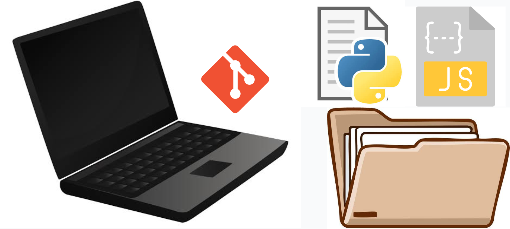
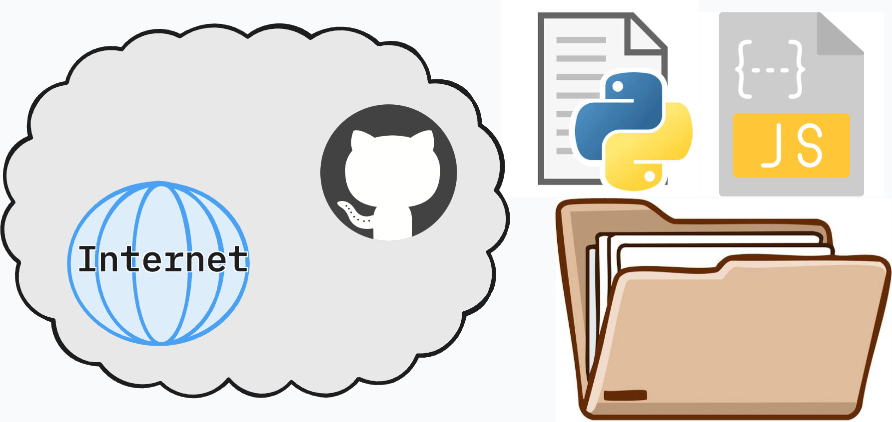

# Committing Your Project

## Introduction

Up to this point, we have explored different ways of creating **memory** for both Claude Code and ourselves, but there is another piece that needs memory too: **our project**. As we continue developing an application, files will change, features will be added, bugs will be fixed, and sometimes we will make changes that we wish we could undo. Instead of manually creating copies of our project every time we reach a safe point, we can use **version control** to intentionally save and recover different states of our work. In this lesson, we will introduce **Git** as the tool responsible for tracking these local save states and **GitHub** as the service that allows us to store and share them in the cloud. We will then connect these tools to Claude Code through the Git CLI and GitHub MCP and create reusable Claude Code **Skills** that simplify two of our most important workflows: **pushing our latest project state to GitHub and pulling it back down when we need it**.

## Lesson

### Saving your Project


The same memory card concept applies here. We want to store our projects state at different points of it's development in a safe place that where we can retrieve and interact with, and, just like a memory card, we want to be able to work on our project from different devices. There's a lot more that goes into this concept that we will cover in much more depth later on, but, for now we will focus on saving your project and the development lifecycle for version control(saving your project state).

The only thing that's really going to change is the mechanism we will be interacting with. Instead of a Memory Card we will use a CLI tool named Git and a cloud storage named Github.

---

### Git & Github


Git and Github are the holding gold standard for Version Control and these tools are designed to work together, but they are NOT THE SAME.

They work by sharing an overarching concept, as we discovered thorugh previous lectures, all software is a combination of files and directories. These files and directories are saved both locally and through the cloud but work independently from one another. Allowing developers to make their own decisions as to when to connect the two.

Let's break them down.

#### [Git](https://git-scm.com/)

Git is a CLI tool that works internally within local machines (laptops/desktops/VMs) and it keeps tracks of files locally. It does this in a very impressive manner but we won't discuss this at length until later on.



Essentially we must initiallize a *git repository* within the project, this allows git to `track` all of the files and directories within the project. You can think of this as taking a screenshot and then ensuring that everything in the screenshot stays in the exact place. When something moves and/or changes git immeditate throws a flag saying "Hey something moved should I take a new screen shot or leave it?".

These screenshots are called *commits* and are essentially a save state of our project. Git will maintain a record of every single one of these screenshots very similarly to what Claude Code does with it's sessions. It allows you to attach messages to the commit so you can easily revert your codebase to a previous state whenever you need to.

This is good for local and self development, but once we are getting ready to share our project we need a place that could be accessed from outside of our machine. Meaning we need to upload everything to a storage location, this action is typically known as *pushing* a commit.

#### [Github](https://docs.github.com/en)



Github is the place where sharing happens, it holds the latest version of your project and shares it with different machines, people, and/or deployment environments. There's a lot more that could be done through Github but for now we will focus on sharing your codebase.

The process is very similar to how *git* functions hence the *Git* in *GitHub*. You'll have to create a repository within your account where you will store your project. From there anytime a machine *pushes* the latest state of their codebase, it will be stored in the cloud. 

Anytime someone needs to grab this project they simply just need to download it, this process is referenced to as a *pull*.

#### Workflow Overview

**START**

When a new project is created you should create a new repository one locally through Git and the other in the cloud with GitHub.

**In Development**

As you make changes to your projet, generate local save states known as *commits* with descriptive messages that will help you identify your safe states.

**Back Up Your Changes**

Now you can back up your save states by *pushing* (uploading) them to your Github Repository.

**Grabbing your Latest Save**

Now when you need to grab your latest state we will simply *pull* (download) the latest state from the repository.

---

### Adding Claude Code

Git is a native CLI tool so Claude Code does really well at working with it without needing additional set up. At most we may want to add a command that takes care of initializing repositories and coordinating the connection between our local Git and Github.

Github on the other hand does require a bit of set up steps. We want to make sure Claude Code holds a standard convention for tool calling and communications between Claude Agents and Github... This should sound familiar. We will accomplish this through the official [Github MCP](https://github.com/github/github-mcp-server).

If you look up how to add the Github MCP to Claude Code you'll come accross this command:

```bash
claude mcp add-json github \
'{"type":"http","url":"https://api.githubcopilot.com/mcp","headers":{"Authorization":"Bearer YOUR_GITHUB_PAT"}}'
```

> From Githubs official documentation found [here](https://github.com/github/github-mcp-server/blob/main/docs/installation-guides/install-claude.md)

Now this asks for a *PAT* which is a Personal Access Token. We will discuss the use of these tokens later on in depth but for now you could think of them as a key card that opens doors. This keycard is assigned to you and only you and it grants you access to your Github capabilities. So let's go through the process.

**Generate the Token**

You can generate a token [here](https://github.com/settings/personal-access-tokens/new)

Ensure to be name it something that can easily be tied to Claude Code and ensure you take your time in the description. It will help you manage these ID cards later on.

From there choose your permissions, for now, and for having no technical experience, I recommend the following:


Finally your token will be generated, copy it and store it somewhere safe. **DO NOT SHARE THIS TOKEN** it is your ID card and it is your responsibility to guard it so only you can use it as intended.

**Add MCP**

Now you can add your GitHub MCP server to Claude Code with your PAT and test out the MCP. Once you are done confirm it was added by running `/mcp` within your claude session.

---

### Connect the Dots

Now we gave access to Claude Code to have the capabilities to interact with both the Git CLI and the GitHub platform so lets connect all the dots. Here's the prompt I'll use:

```text
❯ I want to initialize this project at "./" as a git project. Use both the Git CLI and the GitHub MCP server to initialize this project, commit the projects current state and push it to github with a repository named "bluey-guessing-game". Once completed provide me the URL of the repository so I can view it.                                                      

Do you have any questions?     
```

---

### Creating Commands

Commands have been migrated into `skills` within Claude Code. The new standard is to create a structure like such:

```bash
./.claude/skills/<cmd-name>/SKILL.md
~/.claude/skills/<cmd-name>/SKILL.md
```

Notice that `cmd-name` is exchangeable and how Claude Code will regerence it later on through `/cmd-name` within Claude Sessions.

#### Pushing (Uploading) Your Project

Build the folder structure and let's create a `save-project` command with the following `SKILL.md`:

```md
---
name: save-project
description: Save the current state of the project within Git using the Git CLI and GitHub by leveraging the Github MCP
---

Your job is to generate a new git commit for this project and push it onto its coordinated GitHub repository.

## Input Arguments

Parse the following input from the user provided via \$ARGUMENTS:
- **message**: The commit message (mandatory).
- **repository-name**: The name of the GitHub repository to create if a remote repository is not already attached.

## Workflow

1. Check the current project for an existing `.git` directory. If the directory is missing, initialize a git repo within the project.
2. Ensure a GitHub Repository is attached as the Remote Branch. If this is not present or is invalid, create a new GitHub Repository using the attached GitHub MCP server (using the provided repository-name if available, or the project folder name) and attach it to the local Git.
3. Generate a commit message using the provided message argument.
4. Push the latest commit to GitHub.

## Related

- [CLAUDE.md](../../../CLAUDE.md): project overview and guidelines.
```

Go ahead and execute `/skills` within your Claude Code session. You should be able to see `/save-project` there. If you don't restart your Cluade Code session and it should populate then.

Make a small change to your project and put the `command` into action:

```text
/save-project message:Update Claude Code oriented docs to show connections 
```

#### Pulling (Downloading) Your Project

We are going to follow the same convention as the previos section and generate a skill named `/grab-project` with the following skills file:

```md
---
name: grab-project
description: Using both the GitHub MCP and the Git CLI grab a project and download it to this machine.
---

You are responsible to for pulling the latest commit of a project down from Github and onto this machine by using a combination of the Git CLI and GitHub MCP.

## Input Arguments
Parse the following input from the user provided via \$ARGUMENTS:
- **github-url**: The GitHub URL for HTTPS interactions. This should only be provided when a new project is being populated(optional) 

## Workflow
1. If a $github-url is provided, confirm it's existence with the GitHub MCP, then conduct a git pull, and finally change directories into the pulled down project.
2. If this command is called within an already existing project, use the remote branch to pull down the latest version of the application.

## Related

- [CLAUDE.md](../../../CLAUDE.md): project overview and guidelines.
```

Open your repository (project) in GitHub and edit the files online. You'll notice a green button asking you to commit. Ensure you are descriptive with the commit title, this is the same as a commit message through local git. Now changes on GitHub don't match what's on our local machine. Use `/grab-project` within the Claude Session to pull down the latest version of the project.

Now we have skills that will allow us to commands that will allow us to both PUSH (save-project) and PULL (grab-project) our project from the GitHub service. Later on we can evolve these skills but for now this should suffice.

## Conclusion

Git and GitHub give our projects something similar to the memory systems we have already created for Claude Code: the ability to preserve important states and return to them when necessary. **Git** allows us to track changes and create local checkpoints called commits, while **GitHub** gives those checkpoints a home outside of our machine where they can be accessed, shared, and retrieved. By connecting Claude Code to both systems, we can delegate much of the repetitive work while still understanding the process taking place underneath: **change → commit → push → pull → continue building**. We also transformed these repeated actions into reusable `/save-project` and `/grab-project` Skills, giving Claude Code consistent instructions for how our projects should be saved and retrieved. :chatgpt-content-reference{index="1"} As we continue building more complex applications, Git and GitHub will become much more powerful, but for now the most important habit is simple: **make meaningful changes, create meaningful save states, and regularly back those states up to GitHub.**
